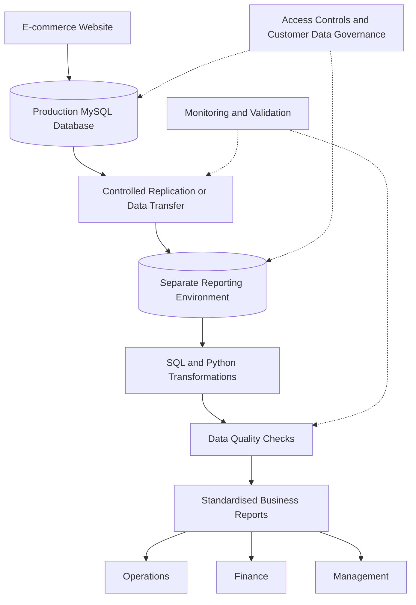

# Kloud Kart: Data Engineering Strategy and Implementation Roadmap


## Table of Contents

- [Project Overview](#project-overview)
- [Business Context](#business-context)
- [Project Objectives](#project-objectives)
- [Proposed Architecture](#proposed-architecture)
- [Technology Strategy](#technology-strategy)
- [Implementation Roadmap](#implementation-roadmap)
- [Built Improvement](#built-improvement)
- [Data Quality and Governance](#data-quality-and-governance)
- [Architecture Decision Records](#architecture-decision-records)
- [Success Metrics](#success-metrics)
- [Risks and Constraints](#risks-and-constraints)
- [Repository Structure](#repository-structure)
- [Future Direction](#future-direction)

## Project Overview

Kloud Kart is an e-commerce business based in Accra, Ghana, processing approximately 4,000 orders per day. As the business grows and prepares for potential expansion into Nigeria, its current reporting processes are becoming increasingly difficult to manage reliably.

This project presents a practical data engineering strategy to improve reporting reliability, protect the live website, strengthen customer-data governance, and establish a foundation for future analytics.

The proposed approach prioritises operational stability, data quality, and cost control before introducing an expensive data warehouse or advanced machine learning solutions.

**The central recommendation is to establish a reliable, controlled reporting environment before investing in advanced analytics.**

## Business Context

Kloud Kart currently operates a MySQL database containing operational information, including orders, inventory, and customer accounts. Reporting workloads share infrastructure with the live website.

The business faces several challenges:

- Monday exports involve hundreds of thousands of rows and have coincided with website slowdowns.
- Operations and Finance sometimes produce inconsistent figures.
- Marketing maintains customer-list copies that are not centrally tracked.
- Reporting depends heavily on manual exports and spreadsheet processing.
- Customer-data deletion and retention processes require stronger controls.
- Management and investors want a clear data strategy to support business growth.

The company also has important constraints:

- The live website and operational database must remain available.
- Inventory information must remain sufficiently fresh to prevent overselling.
- Other business reporting can generally refresh daily.
- Only two data hires are permitted.
- The existing PHP/MySQL developer has limited capacity.
- Management must balance technical improvements with operating costs.

## Project Objectives

The project aims to:

1. Separate reporting workloads from the live production environment.
2. Establish consistent business definitions and reporting procedures.
3. Improve the accuracy and reproducibility of Operations and Finance reports.
4. Introduce basic customer-data copy tracking and governance controls.
5. Reduce unnecessary manual work through targeted automation.
6. Establish measurable outcomes before approving larger technology investments.
7. Prepare the business for future warehousing and demand forecasting when justified.

## Proposed Architecture

The following diagram represents the **proposed target architecture**, not a system that has already been deployed.



### Architecture Principles

- **Protect production:** Reporting must not place unnecessary load on the live website and operational database.
- **Preserve inventory freshness:** Inventory-related processes must meet agreed freshness requirements.
- **Control access:** Customer data must only be accessible to authorised personnel.
- **Validate before reporting:** Business reports should pass agreed quality checks before distribution.
- **Keep costs proportionate:** Begin with a separate reporting environment before committing to a more expensive platform.
- **Design for growth:** Make future integration with a data warehouse possible without requiring an immediate platform migration.

## Technology Strategy

| Component | Proposed approach | Purpose |
|---|---|---|
| Operational database | Existing MySQL | Continue supporting live transactions |
| Reporting infrastructure | Approved second server or read replica | Separate reporting workloads from production |
| Data processing | SQL and Python | Transform and prepare reporting datasets |
| Data validation | SQL/Python checks | Identify missing, duplicated, or inconsistent records |
| Business reporting | Standardised reports and existing spreadsheet tools | Provide consistent operational and financial figures |
| Version control | Git and GitHub | Track changes to documentation, scripts, and decisions |
| Future data warehouse | Evaluate Snowflake or BigQuery | Support larger analytical workloads when justified |
| Future analytics | Assess forecasting after data quality improves | Support evidence-based inventory planning |

Technology selection should be based on actual requirements, expected workload, operating costs, team capability, and maintenance effort.

## Implementation Roadmap

The roadmap is organised into four quarters. Each quarter has outcomes that Nana Adjei, Head of Operations, can verify.

### Quarter 1: Investigate and Plan

**Actions**
- Investigate the customer-data complaint and establish the appropriate response plan.
- Investigate the reported website slowdowns during Monday exports.
- Measure current reporting effort, reconciliation work, and website performance.
- Agree on common business definitions with Operations and Finance.
- Compare the costs and operational implications of a second server and a read replica.

**Verifiable outcomes**
- Documented complaint investigation and response plan.
- Written findings on reporting-related website slowdowns.
- Baseline reporting and reconciliation measurements.
- Approved business definitions.
- Costed proposal for separating reporting workloads.

### Quarter 2: Protect and Control

**Actions**
- Configure and test the approved reporting environment.
- Move suitable reporting workloads away from production.
- Establish monitoring for website performance and replication lag where applicable.
- Introduce the Customer Data Copy Log and documented data-handling procedures.
- Test backup and recovery procedures.

**Verifiable outcomes**
- Tested reporting environment.
- Evidence that reporting does not cause unacceptable production impact.
- Documented inventory-freshness checks.
- Recorded owners and review dates for known customer-data copies.
- Documented backup and recovery test results.

### Quarter 3: Automate and Validate

**Actions**
- Automate priority reporting tasks where practical.
- Introduce repeatable data-quality checks.
- Document reporting logic and reconciliation procedures.
- Compare reporting effort against the Quarter 1 baseline.
- Assess whether a warehouse or forecasting pilot is justified.

**Verifiable outcomes**
- Repeatable priority reports.
- Recorded data-quality and reconciliation results.
- Measured changes in manual reporting effort.
- Documented assessment of future platform requirements.

### Quarter 4: Review and Decide

**Actions**
- Compare performance and reporting outcomes against initial baselines.
- Review customer-data controls, reporting reliability, and operating costs.
- Decide whether a warehouse investment is justified.
- Decide whether a limited demand-forecasting pilot is appropriate.
- Prepare the following year's improvement plan.

**Verifiable outcomes**
- Year-end performance review.
- Documented control and cost review.
- Written decisions on warehouse and forecasting investments.
- Prioritised plan for the following year.

## Built Improvement

### Customer Data Copy Tracking and Monday Reporting Controls

This project includes a practical operational improvement addressing two important weaknesses: untracked customer-data copies and inconsistent Monday reporting.

### 1. Customer Data Copy Log

**File:** `improvement/customer_data_copy_log.md`

The Customer Data Copy Log provides a structured record of known customer-data copies, their locations, responsible owners, backup contacts, and last review dates.

It is intended to help Kloud Kart establish better accountability for customer information and support investigations into customer-data requests, including deletion requests.

**Expected benefits**
- Better visibility of customer-data copies.
- Clear ownership and responsibility.
- Easier investigation of customer-data requests.
- More consistent review of data-handling practices.

### 2. Monday Reporting Checklist

**File:** `improvement/monday_reporting_checklist.md`

The Monday Reporting Checklist provides a repeatable process for preparing, validating, reconciling, and reviewing weekly business reports.

It helps reduce avoidable manual errors and makes it easier to identify differences between Operations and Finance before reports are distributed.

**Expected benefits**
- More consistent reporting procedures.
- Earlier detection of missing or inconsistent figures.
- Clearer responsibility for report preparation and review.
- Improved confidence in reported business numbers.

### 3. Improvement Documentation

The following supporting files explain the improvement and how it should be used:

- `improvement/improvement.md` documents the problem, proposed solution, and expected benefits.
- `improvement/README.md` explains the contents of the improvement folder.

### How Success Will Be Verified

The improvement should be reviewed against measurable outcomes:

- Known customer-data copies have recorded owners and backup contacts.
- Copy records have documented review dates and are updated when circumstances change.
- Monday reports pass agreed validation checks before distribution.
- Differences between Operations and Finance are documented and investigated.
- The team can demonstrate that the procedures are being followed.

**Implementation status:** The repository documents the proposed operational controls and supporting artifacts. Their effectiveness must be confirmed through actual use and review; the documentation alone does not prove that the controls are fully implemented.

## Data Quality and Governance

Reliable reporting requires more than moving data into a separate environment. Kloud Kart must also establish repeatable rules for preparing, validating, accessing, and reviewing data.

### Data Quality Controls

Proposed checks include:

- Identifying duplicate order records.
- Checking required fields for missing values.
- Validating order totals and other important business measures.
- Comparing report totals against agreed source figures.
- Investigating differences between Operations and Finance.
- Monitoring inventory freshness and relevant data-transfer delays.

### Customer Data Governance

Proposed controls include:

- Recording known customer-data copies and their owners.
- Restricting access to authorised personnel.
- Documenting retention and deletion procedures.
- Maintaining evidence of relevant customer-data requests and actions.
- Reviewing procedures against the Ghana Data Protection Act, 2012 (Act 843), with appropriate legal or data-protection guidance where necessary.

These measures are intended to improve accountability and support compliance. They do not, by themselves, establish legal compliance or prove that a particular complaint has been resolved.

## Architecture Decision Records

Architecture Decision Records (ADRs) document important decisions, the alternatives considered, and the reasons for the selected approach.

| ADR | Decision | Rationale |
|---|---|---|
| ADR-001 | Separate reporting from production | Reduce the risk that reporting workloads affect the live website. |
| ADR-002 | Defer warehouse platform | Avoid committing to additional platform costs before requirements and data quality are understood. |
| ADR-003 | Standardise business reporting | Improve consistency between Operations and Finance. |
| ADR-004 | Control customer data | Improve visibility, ownership, and handling of customer-data copies. |
| ADR-005 | Delay demand forecasting | Establish reliable data and reporting processes before introducing predictive models. |

Full decision records are available in the `decisions/` directory.

## Success Metrics

The following measures should be established during Quarter 1 and reviewed throughout implementation.

| Area | Success measure |
|---|---|
| Website reliability | Reporting-related slowdowns and production performance measurements |
| Reporting efficiency | Time required to prepare Monday reports |
| Reporting consistency | Number and size of unresolved differences between Operations and Finance |
| Data quality | Number of failed validation checks and unresolved issues |
| Inventory | Compliance with agreed inventory-freshness requirements |
| Customer data | Proportion of known copies with recorded owners and current review dates |
| Cost management | Actual implementation and operating costs compared with the approved budget |

Targets should be agreed after the initial baselines are measured. This avoids presenting unverified improvements as achieved results.

## Risks and Constraints

| Risk or constraint | Proposed response |
|---|---|
| Reporting affects the live website | Move suitable reporting workloads to an approved separate environment and monitor performance. |
| Inventory becomes stale | Define and monitor freshness requirements before changing inventory-related data flows. |
| Customer-data copies remain untracked | Introduce the copy log, ownership, review procedures, and access controls. |
| Operations and Finance continue reporting different figures | Agree on definitions, standardise calculations, and introduce reconciliation checks. |
| Costs grow before benefits are proven | Use staged implementation and require evidence before approving larger investments. |
| Limited engineering capacity | Prioritise essential controls and automation that can be maintained by the available team. |
| Forecasting produces unreliable recommendations | Defer predictive modelling until data quality and historical data suitability have been assessed. |

## Repository Structure

```text
Kloud Kart project/
├── decisions/
│   ├── ADR-001-separate-reporting-from-production.md
│   ├── ADR-002-defer-warehouse-platform.md
│   ├── ADR-003-standardise-business-reporting.md
│   ├── ADR-004-control-customer-data.md
│   └── ADR-005-delay-demand-forecasting.md
├── improvement/
│   ├── customer_data_copy_log.md
│   ├── improvement.md
│   ├── monday_reporting_checklist.md
│   └── README.md
├── Kloud_Kart_Implementation_Roadmap.md
├── Kloud_Kart_Recommendation.md
├── Kloud-Kart-Board-Presentation.pptx
├── README.md
└── Situation_Diagnosis_Kloud_Kart.md
```

## Future Direction

Once reporting reliability, data quality, and governance controls have been established, Kloud Kart can evaluate additional capabilities in stages.

Potential future initiatives include:

- A cloud data warehouse such as Snowflake or BigQuery.
- Automated operational and financial dashboards.
- More advanced inventory and sales analytics.
- A carefully scoped demand-forecasting pilot.
- Improved analytical support for expansion into Nigeria.

Each initiative should be justified by a defined business need, measurable benefits, realistic implementation costs, and the team's capacity to operate it.

## Conclusion

Kloud Kart's immediate priority is to establish a reliable and controlled data foundation while protecting the live website and maintaining fresh inventory information.

By separating reporting from production, standardising business figures, improving customer-data controls, and automating priority reporting tasks, the company can reduce operational risk and prepare for future growth without committing prematurely to expensive analytics platforms.

The roadmap provides a staged, measurable path from investigation to operational improvement and, eventually, evidence-based investment in advanced analytics.

---

**Project status:** Assessment, planning, and proposed operational improvements. Production deployment, realised cost savings, and performance improvements must be verified separately before being reported as achieved outcomes.