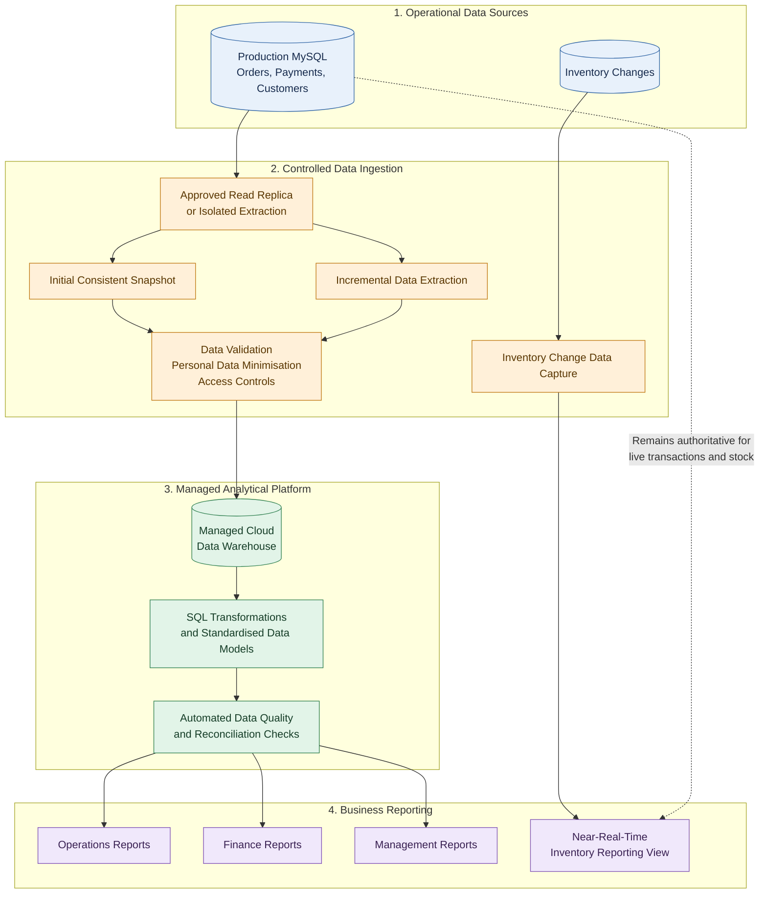

# Kloud Kart Data Engineering Strategy

## Project Overview

This project presents a practical data engineering strategy for Kloud Kart, an Accra-based e-commerce business processing approximately 4,000 orders per day.

Kloud Kart currently operates a MySQL production database of approximately 40 GB. Large reporting exports have coincided with website slowdowns, Operations and Finance produce inconsistent figures, and customer-list copies maintained by Marketing are not centrally tracked.

The objective is to establish a reliable, secure, and cost-controlled reporting platform that supports business growth without placing unnecessary pressure on the live e-commerce system.

## Business Problems

- **Production performance:** Large reporting exports may compete with live application workloads.
- **Inconsistent reporting:** Operations and Finance report different figures.
- **Customer-data governance:** Customer-list copies are not centrally tracked.
- **Manual reporting:** Monday reports require repeated CSV exports and manual reconstruction.
- **Inventory freshness:** Daily reporting may not reflect the latest inventory changes.
- **Future growth:** The architecture must be assessed against a provisional 15–20% annual order-growth assumption.

The growth figure is a planning assumption to validate, not a confirmed forecast. The cause of the reported website slowdowns must also be investigated rather than assumed to be proven.

## Recommended Data Architecture

The recommended direction is to introduce a small managed cloud data warehouse, separate analytical workloads from the live production system, automate data ingestion, and establish consistent reporting definitions.

### Target Architecture Diagram

### How the Architecture Works

1. **Operational sources:** Production MySQL continues to support live transactions, payments, customers, and operational inventory.
2. **Controlled extraction:** An approved read replica or isolated extraction process reduces competition between analytical workloads and production. A consistent initial snapshot is followed by incremental extraction.
3. **Data protection:** Data is validated, unnecessary personal identifiers are excluded or masked before analytical landing where feasible, and access and retention controls are applied.
4. **Centralised warehouse:** The managed cloud data warehouse provides a common analytical foundation for reporting.
5. **Transformations and quality checks:** SQL transformations standardise business definitions and validate data before reports are published.
6. **Business reporting:** Operations, Finance, and management use approved reporting tables rather than independently reconstructing figures from multiple CSV exports.
7. **Inventory exception:** Inventory changes are the single proposed near-real-time reporting exception. An appropriate change-data-capture mechanism updates the inventory reporting view, with monitoring for freshness and failures.

Production MySQL remains authoritative for live checkout, stock reservation, and operational inventory decisions. The inventory reporting view must not replace production transaction processing.

The diagram describes the proposed target state, not an already deployed system.

## Processing Strategy

### Extraction

The initial extraction strategy is designed to reduce production impact while maintaining data consistency.

- Establish a consistent initial snapshot.
- Use incremental extraction for subsequent changes.
- Prefer an approved read replica or other isolated extraction path where feasible.
- Assess change data capture (CDC) if reliable incremental extraction cannot be achieved using available source fields.
- Monitor load completion, failures, duplicate processing, and reconciliation results.
- Define recovery and reprocessing procedures for failed loads.

### Transformation

The proposed approach is **hybrid ELT**, combining controlled ingestion with SQL transformations in the analytical platform.

- Exclude or mask unnecessary personal identifiers before analytical landing where feasible.
- Apply approved access controls and retention rules to data that must be retained.
- Standardise orders, payments, cancellations, refunds, and inventory reporting.
- Agree on revenue definitions with Finance and Operations.
- Validate transformation results before publishing reports.
- Record failures and assign them to an accountable owner.

### Refresh Frequency

| Data domain | Proposed refresh |
|---|---|
| Orders and payments | Daily batch |
| Standard management reporting | Daily batch |
| Customer reporting | Daily batch, subject to approved data controls |
| Inventory reporting view | Near real time |
| Live checkout and stock reservation | Production system remains authoritative |

Daily batch processing is the default. Near-real-time processing is limited to inventory stock-count changes as the single proposed exception.

## Project Deliverables

| Deliverable | Purpose |
|---|---|
| `Situation_Diagnosis_Kloud_Kart.md` | Ranked business and technical risks, assumptions, cost estimates, and data-quality dimensions |
| `Kloud_Kart_Recommendation.md` | Recommended architecture, extraction strategy, processing approach, and ownership |
| `Kloud_Kart_Implementation_Roadmap.md` | Quarterly implementation plan with verifiable outcomes |
| `decisions/` | Architecture Decision Records documenting decisions, alternatives, and trade-offs |
| `improvement/` | Additional operational controls and the proposed FinOps improvement |
| `Kloud-Kart-Board-Presentation.pptx` | Executive-level presentation of the findings and recommendations |

## Architecture Decision Records

The `decisions/` directory records the reasoning behind the major architectural choices.

- **ADR-001:** Separate analytical reporting from production workloads.
- **ADR-002:** Original decision to defer warehouse-platform selection, retained for decision history and superseded by ADR-006.
- **ADR-003:** Standardise business reporting definitions.
- **ADR-004:** Establish controls for customer data and its copies.
- **ADR-005:** Delay demand forecasting until the data foundation is reliable.
- **ADR-006:** Approve the direction of a managed cloud data warehouse, subject to implementation planning and cost assessment.

These records document decisions and recommendations; they do not prove that implementation has been completed.

## Data Quality and Reporting Controls

Every data load should be checked across six dimensions.

| Dimension | Validation question |
|---|---|
| Completeness | Are required records and fields present? |
| Accuracy | Do values match the source and expected business rules? |
| Consistency | Are definitions and calculations consistent across reports? |
| Timeliness | Did the data arrive within the agreed reporting window? |
| Validity | Do values satisfy accepted formats and business rules? |
| Uniqueness | Are unintended duplicate records present? |

Failed checks should be visible, assigned to an owner, and resolved before affected outputs are published.

Revenue definitions must be agreed with Finance and Operations, including the treatment of cancellations, refunds, failed payments, and reporting cut-off times. Reconciliation should establish why figures differ rather than merely forcing reports to match.

## Customer Data Protection

The strategy includes an inventory of customer-data copies, named owners, access controls, retention rules, and documented handling of relevant customer requests.

The investigation should cover applicable production data, exports, spreadsheets, emailed files, reporting stores, and backups. Deletion from one location must not be assumed to remove every copy.

Applicable obligations under Ghana's Data Protection Act, 2012 (Act 843), should be confirmed with the designated privacy or compliance owner. The project should not assume that a complaint proves a breach or that one technical control automatically satisfies all legal obligations.

The `improvement/customer_data_copy_log.md` file provides a proposed operational record for tracking known copies and their ownership.

## Implementation Roadmap

| Quarter | Focus | Verifiable outcomes |
|---|---|---|
| Q1 | Investigate and agree | Complaint ownership assigned, slowdown investigation completed or documented, performance baselines established, and business definitions approved |
| Q2 | Protect and build | Reporting isolation tested, managed warehouse implementation planned and configured as approved, and controlled extraction established |
| Q3 | Automate and validate | Daily reporting pipelines operating, inventory change capture implemented and monitored, and automated data-quality checks producing evidence |
| Q4 | Measure and optimise | Outcomes compared with Q1 baselines, platform costs reviewed, capacity assessed, and a documented decision made on whether forecasting is justified |

The roadmap represents the proposed delivery sequence. Actual completion should be confirmed against implementation evidence and agreed acceptance criteria.

## Ownership

| Role | Primary responsibility |
|---|---|
| Head of Operations | Business priorities and approval of core business definitions |
| Data Engineer | Extraction, warehouse reliability, monitoring, and technical data controls |
| Analytics Engineer / BI Developer | SQL transformations, reporting logic, and reconciliation |
| PHP/MySQL Developer | Production application support and database integration |
| Designated Privacy or Compliance Owner | Customer-data complaint handling and confirmation of applicable obligations |
| Finance Representative | Revenue definitions, reconciliation rules, and financial validation |

Where a role is not yet assigned, management should nominate an accountable owner before the related control is considered operational.

## Cost Management

The proposed FinOps guardrail introduces an approved monthly budget, cost alerts, monthly spending reviews, and measures such as cost per 1,000 orders processed.

The implementation should track:

- Warehouse compute and storage costs.
- Data extraction and transfer costs where applicable.
- Failed pipeline runs and unnecessary reprocessing.
- Cost per 1,000 orders processed.
- Cost per successful data load.
- Staff time spent on manual reporting and reconciliation.

Alert thresholds and spending limits require management approval before implementation. Proposed thresholds, including an 80% budget alert and 100% escalation, remain provisional until approved.

Cost optimisation must not compromise essential production operations, required inventory updates, data quality, or customer-data protections. Critical services must not be automatically disabled solely to meet a budget threshold.

## Success Measures

Progress will be measured against baselines established in Q1.

| Measure | What it demonstrates |
|---|---|
| Website performance during reporting workloads | Whether analytical extraction is affecting the live application |
| Unexplained differences between Operations and Finance reports | Whether shared reporting definitions and reconciliation are improving |
| Staff hours spent preparing and reconciling reports | Whether reporting automation is reducing manual effort |
| Traceability of customer-data copies | Whether copies have identifiable owners and documented handling |
| Inventory reporting freshness | Whether the near-real-time reporting exception meets its agreed freshness target |
| Pipeline reliability and data-quality failures | Whether reporting data is available and trustworthy |
| Infrastructure cost and cost per 1,000 orders | Whether the platform remains cost-controlled as order volumes change |

Numerical improvement targets should be agreed after the baseline is measured. Any reported savings or performance improvements should be supported by measured evidence.

## Additional Operational Improvements

The `improvement/` directory includes supporting controls beyond the core architecture.

- `customer_data_copy_log.md` provides a proposed register for tracking customer-data copies, ownership, backups, and review dates.
- `monday_reporting_checklist.md` provides a repeatable process for preparing and checking Monday reports.
- `improvement.md` describes the proposed Data Platform FinOps Guardrail for budget monitoring, cost visibility, and escalation.

These are proposed operational controls and require assignment, approval, and adoption before they can be treated as active business processes.

## Important Limitations and Assumptions

- The architecture is a recommendation, not evidence of deployed infrastructure.
- The managed warehouse platform has not been selected solely by this strategy; cost, security, operational fit, and implementation effort must be assessed.
- The 15–20% annual order-growth figure is an assumption to validate.
- The relationship between reporting exports and website slowdowns requires investigation.
- Financial exposure estimates are assumption-based estimates, not confirmed revenue losses.
- Near-real-time inventory reporting depends on a suitable CDC implementation, monitoring, and recovery procedures.
- Applicable privacy and compliance obligations should be confirmed by the designated owner.
- Forecasting should be considered only after data quality, reporting reliability, and business readiness have been demonstrated.

## Conclusion

Kloud Kart should establish a controlled analytical data platform that protects production workloads, standardises business reporting, improves customer-data governance, and provides cost visibility.

A managed cloud data warehouse is the recommended direction, with daily batch reporting as the default and near-real-time inventory reporting as the single exception. Delivery should proceed through measurable quarterly outcomes, validated cost assumptions, and clearly assigned ownership.
